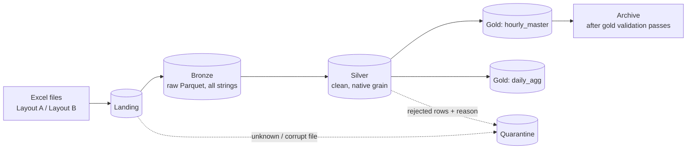

# Architecture

## Data flow

## Orchestration

Settings: `0 6 * * *` IST, `catchup=False`, `max_active_runs=1`, 2 retries (5 min delay). Quality-gate failures are hard failures with no retry.

## Layers

| Layer | Module | Input | Output | Partition |
|---|---|---|---|---|
| Bronze | `ingest_bronze.py` | Excel in landing | Parquet, all string columns, `_source_file`, `_source_layout`, `_ingested_at`, `_batch_id` | `ingest_date` |
| Silver | `clean_silver.py` | Bronze batch | `ts`, `demand_mw`, `source_grain`, `_source_file`, `_batch_id`, `data_month` | `data_month` |
| Gold | `build_gold.py` + `features.py` | Silver | `hourly_master`, `daily_agg` | `data_month` |

### Silver

- Parses timestamps as IST (Layout B format `dd-MM-yyyy HH:mm:ss`) and casts demand to double.
- Rejects each row to quarantine with one reason code.
- On a duplicate timestamp, the later `_ingested_at` wins.
- No resampling: 5-minute stays 5-minute.

### Gold

1. **Resample.** `ts_hour = floor(ts, 1h)`, `demand_mw` = mean of valid readings. For 5-minute sources it is null below `MIN_READINGS_PER_HOUR`.
2. **Spine.** 24 rows for every day with any data. Empty hours stay as null rows (`readings_count = 0`).
3. **Features.** Calendar (including cyclical encodings), lags (1, 2, 3, 24, 48, 168 h), rolling stats (24 h, 168 h), ramp/diff, same-hour 7-day mean.
4. **Write.** `hourly_master` and `daily_agg`, using dynamic partition overwrite.

## Feature rules

- Lags are looked up by `ts_hour - N hours` using time-based range windows, never by row position, so a gap between files cannot shift values.
- Rolling windows cover the hours ending at `ts_hour - 1h` and are null unless every hour in the window is non-null.
- No feature uses the current row's `demand_mw`, so it can serve as the prediction target.
- Nothing is imputed.

## Idempotency and backfill

- A rerun overwrites only its own `data_month` partitions.
- Gold reads silver for the target months plus `LOOKBACK_DAYS` (8) before each.
- When a month's silver changes, the following month is rebuilt too (its first days depend on the end of the previous month).

## Quality gates (`quality.py`)

| Gate | Checks |
|---|---|
| `validate_bronze` | Parquet rows equal Excel data rows (footer included); expected columns present |
| `validate_silver` | Schema matches spec; no duplicate `ts`; demand non-null, positive, in range; kept + rejected = bronze rows |
| `validate_gold` | 24 distinct hours per covered day; unique `ts_hour`; null rate per month under threshold; cyclical values in [-1, 1]; calendar values consistent; lag columns equal demand at `ts_hour - N h`; `daily_agg` consistent |

## Time zone

IST (UTC+05:30, no DST) everywhere: the Airflow default timezone, the container `TZ`, and the Spark session timezone. `ts_hour` is written to Parquet as `timestamp_ntz` (local wall-clock time), so pandas and BI tools show 00:00 as 00:00. Convert to UTC only at a join with a UTC source.

## Design decisions

| Decision | Choice | Reason |
|---|---|---|
| Excel reading | pandas + openpyxl | Spark has no native Excel reader |
| Processing | PySpark, local mode | Spark from silver onward, sized for a 16 GB host |
| Partitioning | `data_month` | Per-day partitions would create hundreds of tiny files |
| Silver grain | Native | Resampling belongs in gold, so silver stays a faithful clean copy |
| Zero demand | Invalid, quarantined | Not physical for the national grid; treated as a sensor dropout |
| Orchestrator | Airflow | Chosen over Prefect |